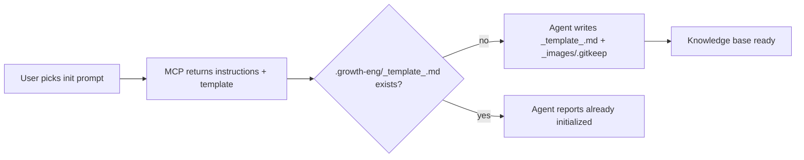

## What

Add the framework's first real capability: an `init` **prompt** on the MCP server that hands the agent everything it needs to bootstrap the `.growth-eng/` knowledge base. The agent writes the files with its own tools (MCP is the brain, agent is the hands — no server-side filesystem access, no cwd problems with npx-launched servers).

Target structure after init:

```
.growth-eng/
├── _template_.md          <- the canonical experiment template
└── _images/               <- screenshots/designs of control and variants
    └── .gitkeep           <- keeps the empty folder in git
```

Once experiments exist: `.growth-eng/<feature>/<experiment>.md` and `.growth-eng/_images/<experiment>/control.png` (plus per-variant images) — one `_images/` subfolder per experiment, named after the experiment doc.



## Files to change

1. **`src/core/services/knowledge-base-service.ts`** (new) — follows the existing `GreetingService` pattern:
   - `KnowledgeBaseService.getExperimentTemplate(): string` — returns the `_template_.md` content (constant below)
   - `KnowledgeBaseService.generateInitInstructions(): string` — returns the prompt text:
     - create `.growth-eng/` and write `_template_.md` verbatim
     - create `.growth-eng/_images/` with a `.gitkeep` file (git doesn't track empty folders)
     - state the image convention: control/variant screenshots and designs go in `_images/<experiment>/`, named after the experiment doc
     - if `_template_.md` already exists, report "already initialized" and don't overwrite anything
     - do not add `.growth-eng/` to `.gitignore`
2. **`src/core/services/index.ts`** — export the new service
3. **`src/core/prompts.ts`** — register the `init` prompt (no arguments), `load` returns instructions + the full template in a fenced block
4. **`README.md`** — small section documenting the `init` prompt and the knowledge-base layout

## `_template_.md` content (verbatim)

```markdown
---
title: ""
feature_flag_key: ""
start_date: ""
end_date: ""
status: draft              # draft | running | ended
conclusion: ""             # won | loss | inconclusive | stopped_early | invalid
winning_variant: ""        # e.g. control, treatment, ...
# Free-form list of custom fields, e.g.
#   - custom_field: 123
custom: []
---

# <title>

## Hypothesis
We believe <change> will <effect> because <insight>.

## Research
<Evidence, prior data, user insights driving this experiment.>

## Control
<The existing experience all variants are measured against.>
<Screenshot/design, if any: ../_images/<experiment>/control.png>

## Variants
| Variant | Description |
|---|---|
<Screenshots/designs, if any: ../_images/<experiment>/<variant>.png>

## Sample size / MDE plan
<Planned sample size, minimum detectable effect, power, alpha, runtime.>

## Metrics
### Goal
<Primary metric this experiment must move.>

### Measurement
<How the metric is measured: instrumentation, attribution window.>

### Guardrails
<Metrics that must not degrade.>

## Results
| Variant | Metric | Value | Delta | Confidence |
|---|---|---|---|---|

## Conclusion
<What we learned and what we do next.>
```

Filled in, `custom` becomes a sequence like `custom:\n  - custom_field: 123` (verified: parses as `[{"custom_field": 123}]`).

## Defaults (stated, no action needed)

- `.growth-eng/` is committed to git (knowledge base is durable), so nothing is added to `.gitignore`
- Feature folders are created later, one per feature, by copying the template — not by `init`
- The `init` prompt is idempotent by instruction: never overwrites existing files
- Image paths in the template are relative (`../_images/...`) since experiment docs live in `<feature>/` subfolders

## Validation

- `bun run lint` and `bun run fmt:check`
- Stdio smoke test: JSON-RPC `prompts/list` shows `init`, and `prompts/get` for `init` returns the instructions with the template content intact
- Front matter parses as YAML (verified with PyYAML: empty form and filled form)

## Out of scope

Feature-folder creation, experiment tools (create/log/analyze), and OpenSpec change capture — this plan is only the `init` prompt and its template.