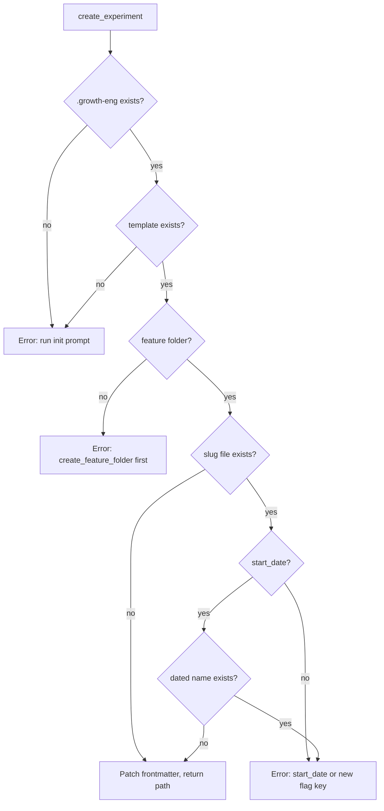

# Spec: Feature-folder + experiment CRUD tools for growth-eng

## Summary
Replace the demo `hello_world`/`goodbye` tools with separate, focused tools that manage the `.growth-eng/` knowledge base on disk: `create_feature_folder`, `list_feature_folders`, `create_experiment`, `read_experiment`, `update_experiment`, `delete_experiment`, `list_experiments`. Creating an experiment copies `_template_.md` into `.growth-eng/<feature>/`, patches its frontmatter from the args, and returns the file path for the agent to fill in the markdown.

## Locked decisions (from your answers)
- **Separate tools per operation** (not the operation dispatcher). Each tool gets a precise zod schema; required fields are enforced by the schema itself, no runtime union needed.
- **Filename**: slugified `feature_flag_key` (`new-flow.md`); on collision `<flag-key>-<MM-DD-YYYY>.md` (hyphen, no spaces); collision with no `start_date` → error telling the agent to pass a start_date or a different flag key.
- **Also remove** the leftover `greeting` prompt and `example` resource (clean slate: one `init` prompt, no resources).
- **Template fix**: `custom: []` → `custom: {}` (comment: "Free-form map of custom fields"), matching the create default.

## Removals
- `src/core/tools.ts`: drop `hello_world` + `goodbye`.
- Delete `src/core/services/greeting-service.ts`; remove its export from `src/core/services/index.ts`.
- `src/core/prompts.ts`: drop `greeting` prompt; keep `init`.
- Delete `src/core/resources.ts` and its wiring in `src/server/server.ts`.

## New service layer
Logic lives in services (repo convention); tools stay thin. Repo root = `process.cwd()`.

- `src/core/services/feature-folder-service.ts` — `FeatureFolderService`
  - `create(name)`: guard `.growth-eng/` exists (else error → run `init` prompt first); guard folder absent (else error); mkdir `.growth-eng/<slug>/`; return path.
  - `list()`: directories in `.growth-eng/`, excluding `_images`.
- `src/core/services/experiment-service.ts` — `ExperimentService`
  - `create(args)`, `read(feature, name)`, `update(feature, name, patch)`, `delete(feature, name)`, `list(feature?)` (omitted feature → all features).
- Shared helpers (slug normalization, `.growth-eng` resolution, frontmatter split/patch) in a small util module.

**Name normalization:** lowercase, collapse non-alphanumeric runs to `-`, trim dashes; error if empty. Applied on create *and* lookup (so `Onboarding` ≡ `onboarding`, and `../` traversal is neutralized). `name` on read/update/delete accepts with or without `.md` (stripped).

## experiment create flow



`create_experiment` args (schema-enforced):
- `feature` (required), `title` (required), `feature_flag_key` (required, also filename base)
- `start_date`, `end_date` (optional, `YYYY-MM-DD` regex; the filename suffix renders `start_date` as `MM-DD-YYYY`)
- `status` (optional, enum `draft|running|ended`, default `draft`)
- `conclusion` (optional, enum `won|loss|inconclusive|stopped_early|invalid`, default `""`)
- `winning_variant` (optional, default `""`)
- `custom` (optional, flat map of scalars — string/number/boolean, default `{}`)

**Frontmatter write** (create + update): line-based patch of the known scalar keys, preserving the template's inline comments; the `custom:` block is regenerated (`custom: {}` when empty, nested `key: value` otherwise). The body's `# <title>` heading is filled from `title`; the rest of the body stays untouched for the agent. Update never renames the file. **Frontmatter parse** (read/list/update): `Bun.YAML.parse` (native in Bun 1.4.3, no new dependency).

## Tool registration (`src/core/tools.ts`)

```ts
// 7 focused tools, each with its own precise schema:
// create_feature_folder({ name })                                   list_feature_folders()
// create_experiment({ feature, title, feature_flag_key, start_date?, end_date?, status?, conclusion?, winning_variant?, custom? })
// read_experiment({ feature, name })     update_experiment({ feature, name, ...patch })
// delete_experiment({ feature, name })    list_experiments({ feature? })
```

`update_experiment` requires at least one patch field (zod `.refine()` at schema level). Every guard error tells the agent the next move (run init prompt / call `create_feature_folder` first / pass start_date or different flag key).

## Tests
- `tests/harness.ts`: add `startServerIn(cwd)` (the SDK server config supports `cwd`) so tools run against a temp sandbox, not this repo.
- `tests/tools.test.ts` (no-LLM, rewritten): tool list is the 7 new tools; prompt list `[init]`; no resources; folder create/list + init guard; create happy path asserting frontmatter (values, defaults, preserved comments, custom block) and untouched body; every guard error; collision → dated filename; bad dates/enums/missing fields rejected; read/update/delete/list round-trip (update preserves body + comments).
- `tests/agent.test.ts` (LLM, rewritten): routing cases — create folder ("Create a feature folder called onboarding" → `create_feature_folder`), create experiment (title + flag key + feature), list experiments; Paris negative case stays.
- `tests/evals.test.ts` (LLM, rewritten): CASES replaced with the new routing cases; 90% gate unchanged. LLM suites skip without `OPENROUTER_API_KEY`.
- `tests/init-prompt.test.ts`: unchanged (template edit flows through `KnowledgeBaseService`).

## Docs
`README.md`: drop hello_world/goodbye mentions; document the 7 tools, the `.growth-eng/<feature>/<experiment>.md` layout, the guard chain, and the updated structure (no `resources.ts`).

## Out of scope
- Deleting feature folders (destructive folder removal stays with the agent's own file tools).
- Renaming experiment files (update patches frontmatter only).
- Nested `custom` values (scalars only).

## Validation
- `bun test tests/tools.test.ts` — full tool coverage, no LLM needed.
- `bun test` — everything (LLM suites run if `OPENROUTER_API_KEY` is set in `.env`, else skip).
- `bun run lint`, `bun run fmt:check`, `bun run knip`.